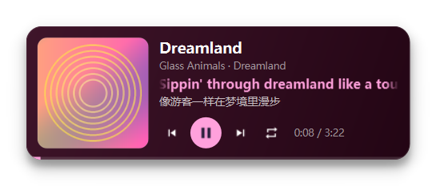

# MaterialFloatPlayerPy

把 BetterNCM 插件 [MaterialFloatPlayer](../desktop%20player/MaterialFloatPlayer) 做成一个**独立进程**的
悬浮播放器：同一个 Material 3 风格卡片（圆角方形封面、播放控制、滚动歌词、跟随封面取色的背景），
但用 Python + Qt 运行，不依赖网易云、不依赖 BetterNCM、不用打包 `.plugin`、不用重启客户端。



## 为什么要有这个版本

插件形态有两个绕不开的成本：

1. **改一次要等一次**：改 UI 要重新打包 `.plugin`、装进 `C:\betterncm\plugins`、重启网易云；
   动画时长、字号、间距这类需要反复看的东西，一次迭代几十秒起步。
2. **窗口外形靠外部手段**：插件拿不到窗口句柄，圆角要靠 Win32 的 `SetWindowRgn` 裁区域、
   阴影要把网易云画的四段矩形阴影逐个裁成圆角环，还要处理物理像素 / 逻辑像素的比例校准 ——
   这些都是借助 PowerShell 脚本 + 后台轮询做出来的。

这个版本是给插件做优化用的“试验台”：窗口完全由自己创建，可以做到逐像素透明的真圆角、
真模糊阴影、逻辑像素的窗口坐标；界面改动跑一次就能看到，适合先把观感调好，再决定哪些
搬回插件里（对照表见下面「和插件的对应关系」）。

播放信息来源也换了：不再读网易云的 DOM 和 JS API，而是读 **Windows 系统媒体会话（SMTC）**，
任何接入系统媒体控制的播放器（网易云、QQ 音乐、Spotify、浏览器、foobar2000……）都能被读到，
播放/暂停/上一首/下一首也是通过同一套接口下发的。

还有第三条路：**由网易云插件直接驱动它**（`--bridge`）。插件继续读网易云自己的播放状态、
拿带翻译的歌词、点网易云自己的播放栏按钮，只把渲染交给这个进程 —— 也就是把"真圆角 +
真阴影"这套窗口架构搬进插件的工作流里。见下面「由网易云插件驱动（桥接）」。

## 运行

```powershell
cd "C:\Users\16268\Documents\ChatGPT\floating window"

# 第一次：装依赖（虚拟环境已经建好，用 --system-site-packages 复用系统的 PySide6/Pillow）
.\.venv\Scripts\python.exe -m pip install -r requirements.txt

# 跑起来
.\.venv\Scripts\python.exe -m mfp_py
```

也可以直接双击 `run.cmd`（用 `pythonw` 启动，没有控制台窗口）。

想在没有播放器的时候看界面，用内置演示数据：

```powershell
.\.venv\Scripts\python.exe -m mfp_py --demo
```

### 命令行

| 参数 | 说明 |
| --- | --- |
| `--demo` | 用内置的假歌单启动（进度自己走，带歌词），不读系统媒体会话 |
| `--bridge PATH` | 由网易云插件驱动：读插件写出的状态文件（`PATH`），把命令写回 `PATH.cmd` |
| `--settings` | 启动时直接打开设置窗口 |
| `--reset-position` | 忽略记住的位置，回到右下角默认位置 |
| `--screenshot PATH` | 渲染一张卡片截图后退出，用来检查界面 |
| `--version` | 版本号 |

托盘图标：显示 / 隐藏悬浮窗、设置、重置窗口位置、退出。卡片右上角的 ✕ 只是把窗口藏起来，
不会再像插件那样等下一次启动客户端才回来。

## 功能

- 独立窗口、置顶、不进任务栏、像桌面歌词一样摆在桌面任意位置，可拖动，位置会记住
  - **全屏游戏上方显示**：前台窗口真的铺满显示器时，用 `SetWindowPos(HWND_TOPMOST, SWP_NOACTIVATE)`
    把它重新提到置顶档最前面，不抢焦点、不轮询（只在检测到全屏时动一次）
- 圆角方形专辑封面（跟随窗口高度自适应），没有封面时显示音符占位
- 控制按钮：上一首 / 播放暂停 / 下一首 / 切换播放模式（列表循环、单曲循环、随机播放、顺序播放）
  - 播放中显示两条竖杠，暂停中显示三角，鼠标悬停会用中文说明“点击后会做什么”
  - 玩家不支持某个命令时（例如没歌单时的上一首/下一首），对应按钮自动变暗并不可点
  - **沉浸模式**：关掉这些按钮和时间，只留封面、歌名、歌词；文字块整体垂直居中
- 滚动歌词：当前行 + 副行（翻译或下一句），带淡入上移切换动画
  - 单句歌词太长时，按这句歌词的时长横向滚动一遍，两侧渐隐；停止滚动后立刻恢复正常显示
- 歌名过长时先显示开头，之后大约每 10 秒整段单向滚一次，滚完停一下直接回到开头
- 进度条与播放时间：进度条贴在底边上，两端跟着卡片圆角收进去
- 背景颜色：专辑主要颜色（OkLab 取色，和插件同一套算法）或自定义颜色
- 白天模式：同一套取色换成浅色背景
- 切歌换色时在旧、新两套配色之间直接插值（约 0.65 秒），不会经过第三种颜色
- 背景不透明度、播放器宽度、圆角半径可调；**五处文字字号分别可调**（歌名 / 作者·专辑 /
  正在播放歌词 / 歌词（下一句）/ 翻译），字号总和超过卡片高度时整体等比缩小，不会被裁掉
- 窗口带 `WS_EX_NOACTIVATE`：点它、悬停按钮都不会抢前台焦点，全屏游戏不会被顶掉
- 日志写到 `%APPDATA%\MaterialFloatPlayerPy\player.log`

## 设置项

| 设置 | 说明 |
| --- | --- |
| 启用悬浮播放器 | 关掉后窗口隐藏，托盘图标还能打开 |
| 背景颜色 | 专辑主要颜色 / 自定义颜色（右侧取色器） |
| 白天模式（浅色背景） | 浅底深字，描边 / 悬停底色 / 进度条槽改用黑色系 |
| 沉浸模式（隐藏播放按钮） | 只留封面、歌词和时间 |
| 播放器宽度 | 260 – 720，窗口高度按 0.35 比例自适应 |
| 圆角半径 | 0 – 32（0 就是直角），同时作用于窗口圆角和封面圆角 |
| 歌名字号 | 8 – 40 |
| 作者 / 专辑字号 | 8 – 30 |
| 正在播放歌词字号 | 8 – 40（同时决定控制按钮的大小） |
| 歌词字号（下一句） | 8 – 40 |
| 翻译字号 | 8 – 40 |
| 不透明度 | 0.4 – 1 |
| 显示歌词翻译 | 打开后副行显示翻译，关闭则显示下一句 |
| 窗口置顶 | 是否把窗口设为置顶 |
| 全屏游戏上方显示 | 仅当前台真的是铺满显示器的窗口时才重新置顶 |
| 显示阴影 | 关掉是完全无阴影（逐像素透明，不会留下方形硬角） |
| 桥接状态文件（插件用） | 插件写出的状态文件路径，`--bridge` 会覆盖它 |

界面里不再有「媒体来源」「歌词来源」两个选项：由插件驱动时曲目、进度、播放模式和歌词
都直接来自网易云。要单独用系统媒体会话或演示数据，用命令行参数（`--bridge` / `--demo`）。

## 由网易云插件驱动（桥接）

插件那边（`desktop player/MaterialFloatPlayer` 1.1.0 起）有一个「使用 Python 悬浮窗」开关：
打开后插件不再用网易云自己的窗口，而是把界面交给这个进程，两边用 `C:/betterncm/` 下的一组文件交换。

```
插件 -> Python：mfp-bridge.json        播放状态（每次 publishState，约 500ms）
                mfp-bridge.json.lyric  歌词（变化时写一次，带翻译和每句时长）
                mfp-bridge.json.ctl    show / hide / reload / settings / quit
Python -> 插件：mfp-bridge.json.cmd     toggle / play / pause / next / prev / mode / close / quit
                mfp-bridge.json.beat    心跳（插件据此判断要不要把它重新拉起来）
```

手工跑一遍（不装网易云也能验证；`tools/fake_plugin.py` 会扮演插件写这些文件）：

```powershell
.\.venv\Scripts\python.exe tools\fake_plugin.py            # 另一个窗口，假装自己是插件
.\.venv\Scripts\python.exe mfp.py --bridge "$env:TEMP\mfp-bridge.json"
```

这条路的取舍：曲目、进度、播放模式、歌词全部来自插件（歌词是 liblyric 的逐行/翻译版本，
比按歌名去搜更准），封面链接由插件给、这里下载；而窗口的一切（圆角、阴影、动画、字体、
位置记忆、设置界面）都在这个进程里，改起来不用打包 `.plugin`、不用重启网易云。
反过来，插件不在时它自己读 SMTC 也能跑 —— 这就是前面那条路。

进度这一项要注意：播放栏只给出整秒，插件会补上自己经过的时间（`smoothPosition()`），
Python 侧再钳一次"播放中不回退"，所以进度条和秒数是连续的、不会每秒回跳。

几个已经踩过的坑，写在这儿免得重复踩：

* **单实例**：用内核命名互斥体（`Local\MaterialFloatPlayerPy`）。手动开的那个实例如果占着位置，
  插件拉起来的实例会写一个 `quit.request` 请它让位再接管 —— 否则桌面上会出现两张卡片。
* **心跳要早写**：`mfp.py` 在 import Qt 之前就先写一次 `.beat`，否则插件要等十几秒（冷启动）
  才知道"我已经起来了"，期间它会以为启动失败、反复重拉。
* **`.venv\Scripts\pythonw.exe` 是启动器**，会再拉起真正的解释器，所以任务管理器里是两个
  pythonw 进程（父子），不是两个悬浮窗。
* 插件那边的 `betterncm.fs.*` 是异步 API（返回 Promise），读文件必须 `.then`；
  这属于插件侧的事，记在插件仓库的 `docs/python-window.md` 里。
* 出问题先跑 `.venv\Scripts\python.exe tools\probe_bridge.py --app`：它把插件写出的
  状态/歌词、桥接来源的解析结果、取到的配色和卡片的内部状态一次打出来，不用开窗口。

按钮：显示悬浮窗、隐藏悬浮窗、重新加载悬浮窗、重置窗口位置、打开数据目录。

## 歌词

插件是按网易云歌曲 id 找歌词；独立版本没有这个 id，只有系统媒体会话给的歌名和歌手，所以：

1. 先看 `%APPDATA%\MaterialFloatPlayerPy\lyrics\` 下有没有 `歌名.lrc` / `歌名 - 歌手.lrc`；
2. 有网络且歌词来源是「在线获取」时，用歌名 + 歌手搜索网易云公开接口，取 LRC 与翻译（`tlyric`）合并；
3. 都没有就显示“暂无歌词”，不影响播放。

解析规则和插件一致：一行多个时间戳、翻译按最近时间戳（≤1.2 秒）挂到原句、每句按下一句时间算出
持续时间（最后一句 6 秒）用来决定横向滚动的时长。结果按曲目缓存在 `cache\lyrics\`。

## 和插件的对应关系

| 职责 | 插件（`desktop player/MaterialFloatPlayer`） | 这个版本 |
| --- | --- | --- |
| 播放状态 | 读 `#main-player` 的 DOM + `betterncm.ncm.getPlayingSong()`，用“进度是否在走”判断播放中 | `winrt-Windows.Media.Control` 读 SMTC 会话（`PlaybackStatus`、`TimelineProperties`） |
| 播放状态（桥接） | 同上，插件读到的原样写进 `mfp-bridge.json` | `mfp_py/bridge.py` 读同一批文件，不经过 SMTC |
| 播放控制 | 点击网易云播放栏按钮，兜底调 `audioplayer.play/pause` | SMTC 的 `TryPlayAsync / TryTogglePlayPauseAsync / TrySkipNextAsync …` |
| 播放模式 | 点击播放栏 `.type` 按钮 | SMTC 的 `TryChangeShuffleActiveAsync` + `TryChangeAutoRepeatModeAsync`（尽力而为，见下） |
| 歌词 | `liblyric` 或 `LibEAPIRequest` 插件，按歌曲 id 取 | 本地 `.lrc` → 网易云公开接口按歌名搜索；同一套 LRC 解析 / 翻译合并 / 时长补全 |
| 歌词（桥接） | 同上 | 直接用插件写出的 `mfp-bridge.json.lyric`（含翻译与每句时长） |
| 取色 | canvas 采样封面 → OkLab 聚类 → 生成配色 | 同一套算法（`mfp_py/color.py` 是 `src/main.js` 取色部分的直译） |
| 界面 | 注入到网易云窗口页面的 HTML/CSS/JS（`src/window.js`） | Qt 自绘卡片（`mfp_py/ui/card.py`），比例与动画参数一一对应 |
| 状态传递 | 主窗口 ↔ 悬浮窗通过 `localStorage` 交换 | 同一个进程内的内存对象，没有序列化和轮询延迟 |
| 圆角 | `SetWindowRgn` 裁窗口区域 + CSS 圆角两层对齐 | 半透明窗口逐像素 alpha，只有一层真圆角（抗锯齿） |
| 阴影 | 按设置给网易云的四段 OrpheusShadow 窗口设裁剪区域，移动后重做 + 15 秒兜底 | `QGraphicsDropShadowEffect`，就是卡片圆角轮廓的模糊 |
| 尺寸 / DPI | 传物理像素、页面是逻辑像素，用“申请值 / 实测值”解出比例校准 | 两侧都是逻辑像素，`devicePixelRatio` 由 Qt 处理，不需要校准 |
| 全屏游戏上方 | 生成 PowerShell 脚本（纯 ASCII、先声明 DPI 感知）执行 Win32 调用 | 进程内 `ctypes` 调 `SetWindowPos`（`mfp_py/win.py`），同样的 `SWP_NOACTIVATE` |
| 设置界面 | BetterNCM 插件管理页里的表单 | 独立的设置窗口，同样的选项和取值范围 |

## 比插件简单或更稳的地方

- **圆角**：插件要同时对齐 CSS 圆角和窗口区域圆角，错开就会出现“两层圆角 + 外圈锯齿”；
  这里是半透明窗口逐像素 alpha，只有一层，天然抗锯齿，改半径不用重设区域。
- **阴影**：插件要靠外部脚本裁剪网易云画的阴影窗口，移动 / 改尺寸后还要重做一次；
  这里是卡片的模糊轮廓，跟随尺寸、圆角、透明度一起变。
- **尺寸与位置**：插件要把逻辑像素乘 `devicePixelRatio` 再实测反解缩放比；
  这里 `move/resize` 直接用逻辑坐标，保存的位置换显示器后会被夹回可见区域。
- **拖动**：插件拖动会让窗口短暂闪烁（每次都要重设圆角区域），这里就是普通的窗口移动。
- **最小宽度下的排版**：插件在 260 宽时时间文字会和播放按钮叠在一起；这里算过空间，
  放不下就不画时间文字，并且把标题/歌词块裁剪在按钮上方（和插件 `overflow:hidden` 的行为一致）。
- **不抢焦点**：卡片窗口是 `WS_EX_NOACTIVATE`（Qt 的 `WindowDoesNotAcceptFocus`），
  点击 / 悬停都不会把前台焦点从全屏游戏手里拿走；全屏时也不弹悬停提示框
  （提示框是另一个置顶窗口，会落到游戏上面）。插件那版悬浮窗当年只能靠
  `spec_window: false` 绕开"点它就激活网易云主窗口"，这里是一步到位。

## 已知限制

- **播放模式**：SMTC 只能表达“循环 / 单曲 / 无循环”和“随机开 / 关”，没有「心动模式」；
  而且是否响应由播放器决定 —— 网易云不一定会接受系统下发的 shuffle / repeat 改动。
  按钮会按真实状态显示，玩家忽略时会在 2.5 秒后回到真实状态（不做“假成功”）。
- **封面**：封面同样来自 SMTC，绝大多数播放器都会提供；个别播放器（以及用
  `MediaPlayer` 自己发布的会话）不上传缩略图，这时显示音符占位。
- **独占全屏游戏**：由 DWM 直接把显示输出交给游戏，普通窗口物理上盖不上去，
  这是系统级覆盖层（Xbox Game Bar）才有的能力；窗口化 / 无边框 / 开全屏优化的游戏可以。
- **歌词匹配**：靠歌名 + 歌手搜索，翻唱、纯音乐、外文同名曲可能匹配到别的版本；
  需要精确匹配就放一个本地 `.lrc`。
- 只在 Windows 上跑（SMTC 与 `ctypes` 都用的是 Windows API）。

## 源码结构

```
mfp_py/
  __main__.py          python -m mfp_py 入口
  app.py               组装：设置、媒体来源、歌词、取色、托盘、主循环
  config.py            设置读写（%APPDATA%\MaterialFloatPlayerPy\config.json）
  color.py             OkLab 取色 + Material 配色（src/main.js 取色部分的直译）
  media.py             Track / Snapshot 数据模型与媒体来源接口
  smtc.py              Windows 媒体会话（SMTC）来源：读状态、下命令
  bridge.py            插件桥接来源：读插件写的状态 / 歌词，把命令写回插件
  demo.py              内置演示歌单、演示歌词、生成封面
  lyrics.py            LRC 解析、翻译合并、本地 / 在线获取
  win.py               ctypes：前台全屏判断 + 置顶（对应插件的 PowerShell 脚本）
  ui/
    card.py            悬浮卡片：布局、绘制、动画、交互
    window.py          无边框半透明窗口、阴影、位置记忆
    icons.py           与插件同一份 SVG 路径的 Material 图标
    settings.py        设置窗口
tools/
  fake_player.py       自建一个 SMTC 会话（假歌 + 生成封面 + 时间轴），离线联调用
  fake_plugin.py       扮演网易云插件写桥接文件、收命令，用来验证桥接这条路
  probe_bridge.py      打印插件写出的状态 / 歌词 / 配色，以及卡片内部状态（--app）
  probe_smtc.py        打印当前系统媒体会话，或下发一条命令看反应
  probe_thumbnail.py   单测封面字节读取（IBuffer → bytes）与取色
  preview.py           渲染各种界面变体，输出 preview/sheet.png 对照图
  selftest.py          集成自测：读到会话、点按钮真的会暂停播放器、拖动会记住位置
```

## 开发工具

```powershell
# 现在系统里有什么媒体会话
.\.venv\Scripts\python.exe tools\probe_smtc.py
.\.venv\Scripts\python.exe tools\probe_smtc.py --command toggle --watch 6

# 没有播放器也能测：自己发布一个会话（循环一段轻音，带封面和时间轴）
.\.venv\Scripts\python.exe tools\fake_player.py --mute

# 封面读取 + 取色自测（不需要播放器）
.\.venv\Scripts\python.exe tools\probe_thumbnail.py

# 界面变体对照图（暗色 / 白天 / 沉浸 / 直角 / 窄 / 宽 / 半透明 / 长歌名 / 暂停 / 无歌曲 / 设置窗口）
.\.venv\Scripts\python.exe tools\preview.py --out preview

# 集成自测（先在另一个窗口跑 fake_player）
.\.venv\Scripts\python.exe tools\selftest.py
```

`fake_player` 发布的是真实的 SMTC 会话，所以它同时能验证读状态和下命令；它唯一做不到的是
封面 —— 未打包的桌面程序用 `MediaPlayer` 发布会话时，缩略图不会传到 SMTC，所以封面那条路
由 `probe_thumbnail.py` 单独验证。

`fake_plugin` 则把桥接这条路整条跑通（状态、歌词、封面下载、命令回传），
`tools/selftest.py --bridge ...` 会断言"点播放按钮确实写出了命令"。

## 下一步可以搬回插件的东西

- **最小宽度下的排版**：先量再画（时间放不下就不画、文本块裁剪在按钮上方），比让元素互相压住好。
- **播放模式的呈现**：状态用真实值、命令后给 2–2.5 秒的“意图”显示再回到真实值，不假装成功。
- **动画参数集中**：滚动一次 2.6 秒 + 开头停 5 秒 + 尾部停 1.6 秒、单句歌词 `clamp(2600, 24000)`
  与 `hold/glide` 的算法，在两个项目里是同一份，改的时候两边一起改。
- **icon 路径保持同源**：`mfp_py/ui/icons.py` 与插件 `src/window.js` 里的 SVG `d` 完全一致，
  换图标只改一处再同步另一处。

## 和插件的关系（现状）

老的那条路（插件用 `winhelper.launchWindow` 建窗口）保留着，是默认；「使用 Python 悬浮窗」
是开关，随时可以在设置页里来回切。真要彻底统一，可以让插件只保留"数据与控制"，把渲染全部
交给这个进程 —— 桥接协议已经把这件事铺好了。
